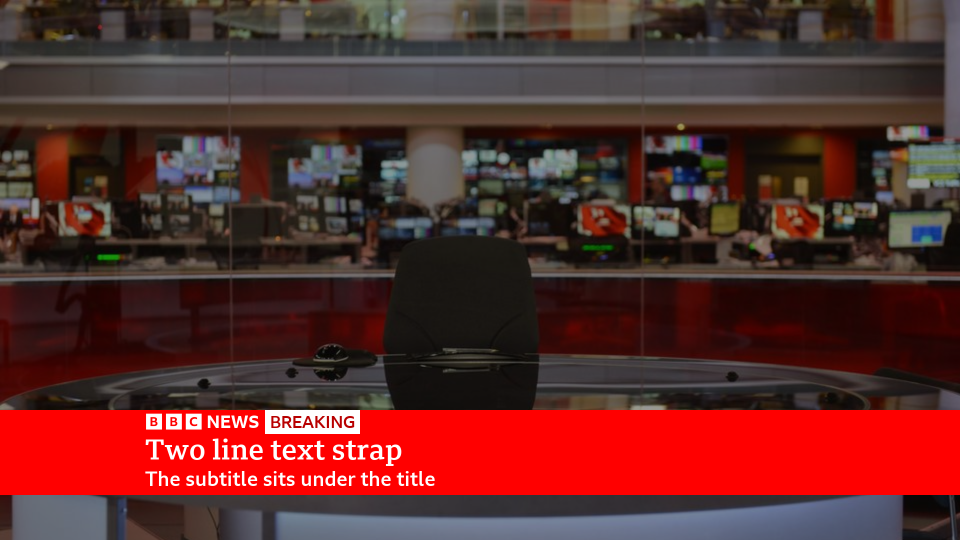
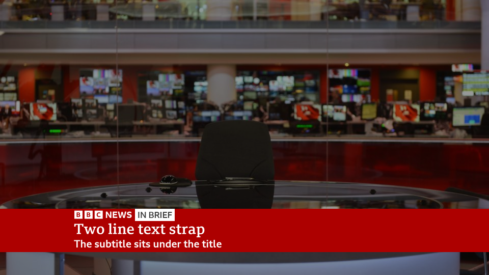
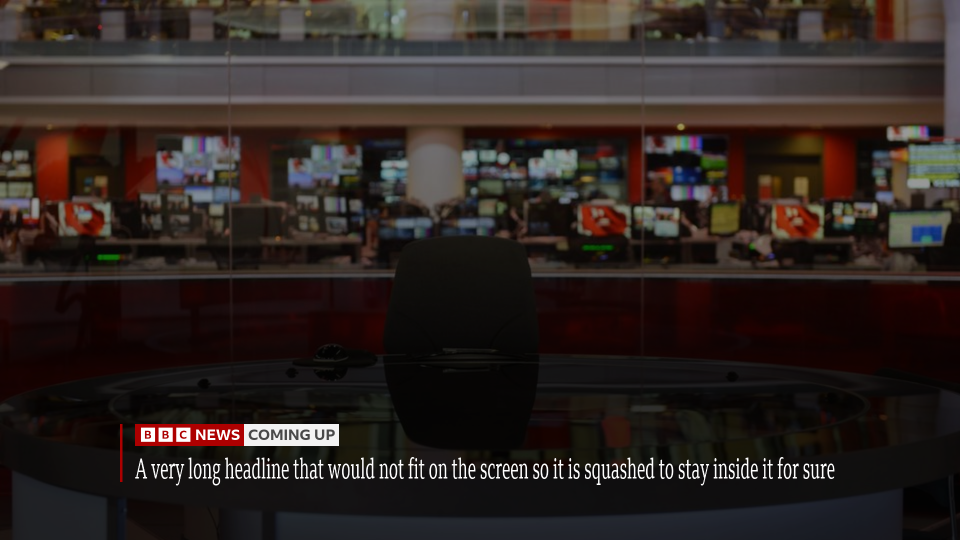
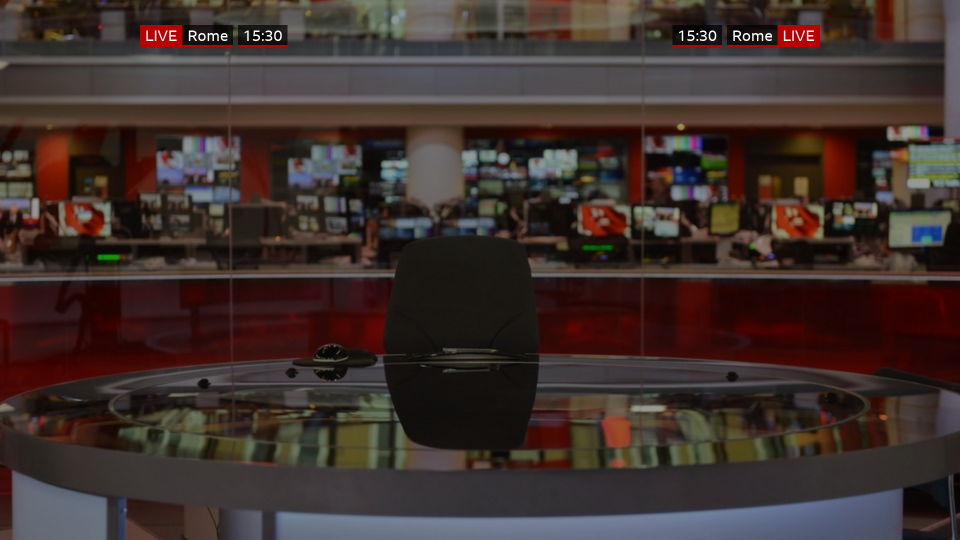
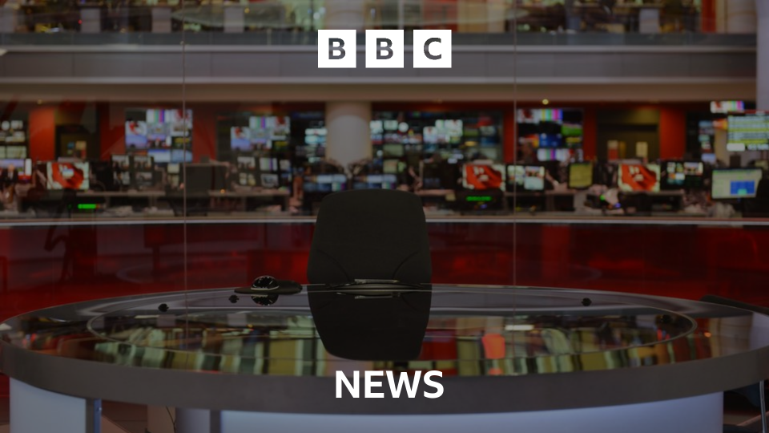

# Viz2.0 (BGamerManu fork)

A free, LÖVE-based BBC News style graphics engine: News Bar with ticker and clock, text and BREAKING straps, name straps, programme badges, headlines, LIVE bugs, titles and transitions. It is controlled over the network (port `10655`) by [VizHelper](https://github.com/BGamerManu/VizHelper) and is meant to be keyed over a video source (the window has a transparent background).

This is a fork of [playsamay4/Viz2.0](https://github.com/playsamay4/Viz2.0), made and maintained by Manuel_Ottani. I am trying to keep it updated as far as I can. **It needs the matching fork of VizHelper** for the new controls.

## Installation

1. Go to [Releases](https://github.com/BGamerManu/Viz2.0/releases) and download the latest Windows zip. It already contains LÖVE 11.4: unzip it and run `avvia-viz.bat`.
2. On Linux/macOS install [LÖVE 11.4](https://love2d.org/) and run `love Viz2.0` on the source folder (or on the `.love` file).
3. Start VizHelper afterwards. When it connects, the splash screen fades out. If VizHelper runs on another computer, set Viz2.0's IP in VizHelper's settings.

Useful keys in the Viz2.0 window: `F11` scaled / full window, `N` hide the splash screen, `G` Gill Sans mode, `Numpad *` backdrop. All of them also have a button in VizHelper's *Testing area*.

## What is different in this fork

### Straps swap in place

Going from the text strap to the breaking strap (and back), or from a one line to a two line text, **never takes the strap down**:

- The red BREAKING box and the BREAKING tag come up over the strap, or sink away again.
- If the text is the same text on the same number of lines, it does not move at all: only the red box and the tag are added or removed. If it is different, the old text rolls out of the top while the new one rolls in from below.
- One line ↔ two lines of the text strap (and of the breaking strap) roll in place too.
- Works with `Show-LowerThirdText`, `Show-BreakingLowerThird` and `Show-BreakingTitle`.

### Headlines

- Headlines are **one line**. A `|` is just a space.
- A headline that is too wide first shrinks (down to 56 px, about 55 characters), and if it still does not fit it is **squashed sideways** so it never leaves the screen.
- The BBC NEWS box (and the optional `COMING UP` box) and the vertical bar follow the height of the text, so a smaller headline does not leave a gap. The box and the top of the bar sit 10 px higher than before, and the background behind the headline is a little darker.
- Set `HeadlineBBCBox = false` in `Headlines.lua` to leave the BBC NEWS box out.

### LIVE bug

`Show-PlaceName` / `Show-PlaceNameWithTime` take an optional `Side`: `"left"` (default), `"right"` or `"both"` (a bug on each side at the same time). The right hand bug is the mirror image of the left one: `[time] [place | LIVE]`.

### Titles

`Show-TitleLogo` takes an optional `Style`: `"chameleon"` (the BBC blocks with **NEWS** under them, or **WORLD NEWS** when the channel name of the branding has "world" in it) or nothing / `"legacy"` for the red boxed BBC NEWS logo. A title leaves before another one, a headline or the News Bar comes in, and the other way round.

### Other changes

- **Single line BREAKING strap.** `Show-BreakingLowerThird` only needs the top line; with a subtitle it is the usual two line strap.
- **BREAKING headline is optional.** `Show-BreakingTitle` with an empty `Text` shows just BREAKING; `Advance-BreakingTitle` scrolls to the headline.
- **No white ticker needed for straps.** The text and breaking straps come up on their own when the ticker is down, and sink out of sight when hidden.
- **Badges.** The programme badge goes back down with the strap and always comes in on the row its clip window is on; it is no longer re-shown with the text and colours of the last info badge.
- **Keyboard-only features have requests**, used by VizHelper's Testing area (see below).
- The two line text no longer leaves its old title parked above the strap after rolling out.
- The splash screen text was rewritten.

## Requests

Everything is a `headline` event with a table, `Type` being one of:

| Group | Types |
|---|---|
| Headline | `Show-Headline` (`Text`, `Style` = `"ComingUp"`), `Next-Headline`, `Hide-Headline`, `Show-Headline-KeepText` |
| Titles | `Show-TitleLogo` (`Style`), `Hide-TitleLogo`, `Show-TitleLogoInstant`, `Hide-TitleLogoInstant` |
| News Bar | `ShowLowerThird`, `HideLowerThird`, `ToggleL3`, `Show-TickerOnly`, `Hide-TickerOnly`, `Show-Clock`, `Hide-Clock` |
| Text strap | `Show-LowerThirdText` (`Text` = `top\nsub1\nsub2`, `BoxText`), `Hide-LowerThirdText` |
| Breaking strap | `Show-BreakingLowerThird` (`Text` = `top\nsub1\nsub2`), `Hide-BreakingLowerThird`, `Show-BreakingTitle` (`Text`), `Advance-BreakingTitle` |
| Name strap | `Show-PresenterName` (`Text` = `name\nrole`), `Hide-PresenterName` |
| Badges | `Show-ProgramBadge`, `Set-ProgramBadge`, `Hide-ProgramBadge`, `Remove-ProgramBadge` (`Text`, `TextColor`, `BackgroundColor` as `"r/g/b"`), `Show-SocialsBadge`, `Hide-SocialsBadge`, `Show-CreditBadge`, `Hide-CreditBadge` |
| LIVE bug | `Show-PlaceName` (`Text`, `Side`), `Show-PlaceNameWithTime` (`Text`, `Offset`, `Side`), `Hide-PlaceName` |
| Branding | `Set-Branding` (`channelName`, `opaque`, `coloredStrap`, `ThemeColor` = `{r,g,b}`, `clockMode` = `default` / `off` / `breakfast`) |
| Ticker | `GetTickerText`, `GetTickerTextTable`, `KillTicker`, `ResumeTicker` |
| Misc. | `Wipe`, `Flash`, `Show-BreakfastIntroClock`, `Hide-BreakfastIntroClock`, `Toggle-Backdrop`, `Toggle-GillMode`, `Hide-Splash`, `Toggle-WindowMode`, `Load-AVPlayout`, `Play-AV` |

## License

Viz2.0 is licensed under the [GNU General Public License v3.0](LICENSE). Original work by [playsamay4](https://github.com/playsamay4/Viz2.0).
